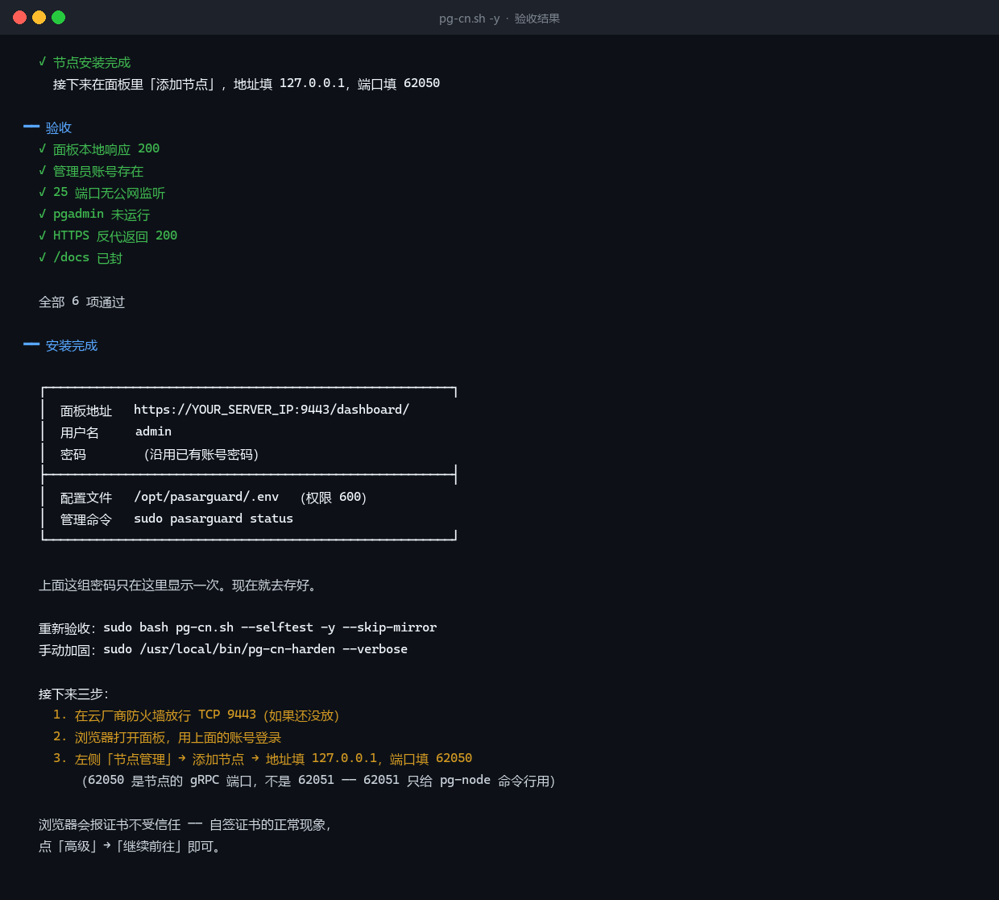
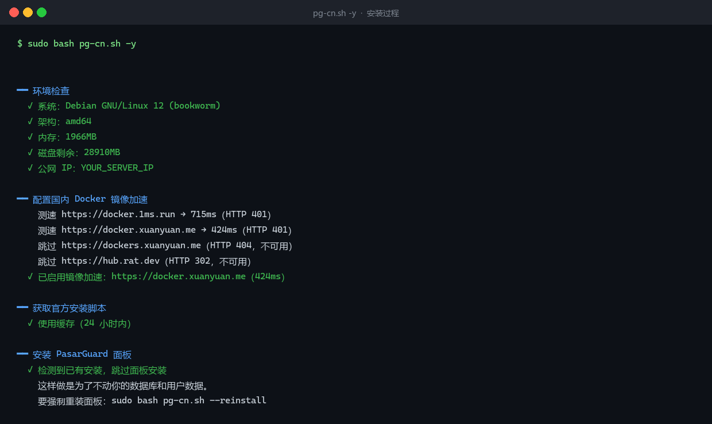
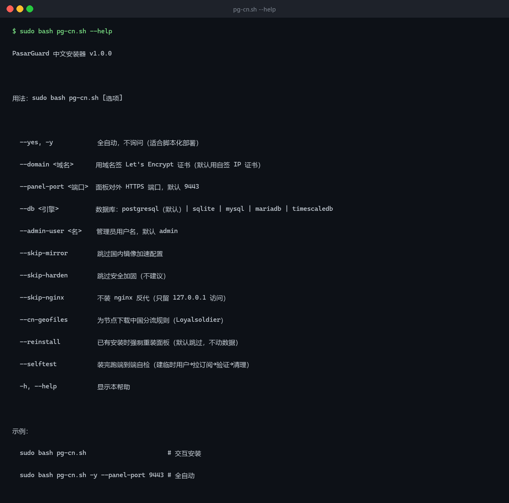

<div align="center">

# pasarguard-cn

**A Chinese-language, security-hardened wrapper around the official PasarGuard installer**

[](https://www.gnu.org/software/bash/)
[](https://www.debian.org/)
[](LICENSE)

[中文](README.md) | **English**

No wheel reinvention — the actual install still runs the official script. This repo only fixes five things the official one doesn't.

</div>

---

## What it looks like

**Post-install verification** (all six checks pass):



**Install run**: environment check → mirror speed test → idempotent guard (skips if already installed, leaves your data alone):



**CLI flags**:




---

## What this is (and isn't)

**This is not an official PasarGuard project.** It is a third-party wrapper.

| | |
| :--- | :--- |
| **Core install** | Calls the official `pasarguard.sh` / `pg-node.sh`, **never modifies them** |
| **This repo adds** | Chinese UI, automatic admin account, default hardening, China mirrors, nginx reverse proxy |
| **Upstream updates** | Picked up automatically — the official script is re-fetched on every run, no fork |
| **If something breaks** | Check the [official docs](https://docs.pasarguard.org/) first |

Upstream behavior is out of this project's control. If an upstream change breaks this
script, the official docs win — please open an issue.

---

## Why this exists

The official installer is genuinely good: 5 database engines, Let's Encrypt, Telegram
backups, multi-node, 8 distros, CI. But installing it on my own box, I hit five problems
it doesn't handle:

### 1. No admin account after install

The official script finishes with the `admins` table empty:

```bash
$ docker exec pasarguard-postgresql-1 psql -U pasarguard -d pasarguard \
    -t -A -c "SELECT count(*) FROM admins;"
0
```

It only sets `PGADMIN_EMAIL` / `PGADMIN_PASSWORD` — that's the database admin UI, not
the panel account. You need to create the panel login yourself, and nothing tells you that.

### 2. pgadmin starts by default and binds port 25 to the internet

The official compose file runs pgadmin as a persistent service. Its image bundles
Postfix, which under `network_mode: host` binds `0.0.0.0:25` directly:

```
$ ss -tln | grep ':25 '
LISTEN 0  100  0.0.0.0:25  0.0.0.0:*   users:(("master",pid=1047465))
```

An open port 25 gets you scanned into a spam relay within days. Once your IP lands on
a blocklist, **your proxy nodes die with it**.

### 3. No `--yes`, so it can't be automated

Every run is fully interactive. Provisioning five boxes means babysitting five prompts.

### 4. No Chinese anywhere

Errors and prompts are English-only.

### 5. Docker pulls time out in mainland China

The default registry is unreachable; you need a mirror, chosen per-server.

---

## What it adds

### Hardening is **replayable** — upgrades can't silently undo it

Hardening lives in `/usr/local/bin/pg-cn-harden`, replayed by a systemd timer at boot
(+2 min) and every 15 minutes. If an update rewrites the compose file, the next tick
puts it back.

### Re-running is safe (idempotent)

Every step checks first. Running twice is a no-op, not a disaster.

### Built-in end-to-end self-check

`--selftest` verifies panel reachability, node status, subscription endpoint, and the
admin account — so you know it actually works, not just that it installed.

---

## Quick start

```bash
# Interactive
sudo bash pg-cn.sh

# Fully automated
sudo bash pg-cn.sh -y --panel-port 9443

# With a domain + Let's Encrypt
sudo bash pg-cn.sh --domain panel.example.com

# Custom port
sudo bash pg-cn.sh -y --panel-port 2083
```

### Before you start

**Open the panel port in your cloud provider's firewall.** Most "install failed"
reports are actually a closed security group. The script cannot do this for you.

---

## After install: three steps

### 1. Log in

`https://YOUR_IP:9443` — use the admin account the script created and printed.

### 2. Add a node

Panel → Nodes → Add. The script already installed `pg-node`; you just need to
paste the API key.

### 3. Create a user

Panel → Users → Add, then attach a subscription.

---

## Command line

| Flag | Meaning |
| :--- | :--- |
| `--yes`, `-y` | Fully non-interactive |
| `--domain <domain>` | Let's Encrypt cert (default: self-signed IP cert) |
| `--panel-port <port>` | HTTPS port (default 9443) |
| `--db <engine>` | `postgresql` (default) \| `sqlite` \| `mysql` \| `mariadb` \| `timescaledb` |
| `--admin-user <name>` | Admin username (default `admin`) |
| `--skip-mirror` | Skip China mirror detection |
| `--skip-harden` | Skip hardening (not recommended) |
| `--skip-nginx` | No reverse proxy, 127.0.0.1 only |
| `--cn-geofiles` | Install Loyalsoldier geofiles on the node |
| `--reinstall` | Force reinstall even if already present |
| `--selftest` | Run end-to-end checks after install |
| `-h`, `--help` | Show help |

---

## Troubleshooting

### Panel won't load

```bash
# 1. Is the panel alive locally?
curl -s -o /dev/null -w '%{http_code}\n' http://127.0.0.1:8000/
# expect 200

# 2. Is nginx up?
systemctl is-active nginx

# 3. Is the port listening?
ss -tlnp | grep 9443
```

If step 1 passes but the browser fails, it's almost always the cloud firewall.

### Node shows `error`

Check the "message" field in the panel. Common causes:

- `self-signed certificate` → cert mismatch between node and DB
- `IP address mismatch` → cert SAN missing `127.0.0.1`
- `connection refused` → node container not running

For the first two:

```bash
sudo /usr/local/bin/pg-cn-harden --verbose
docker compose -f /opt/pasarguard/docker-compose.yml restart pasarguard
```

### User connects but has no internet

```bash
# Is the node synced to the user?
docker exec pasarguard-postgresql-1 psql -U pasarguard -d pasarguard \
  -t -A -c "SELECT username, status FROM users;"
```

### Subscription returns 404

```bash
grep -rn '/sub/' /etc/nginx/sites-available/
```

It should `proxy_pass` to the panel, nothing else.

---

## Tested scope (read before publishing)

| | |
| :--- | :--- |
| **Fully tested** | Debian 12 — fresh install, idempotent re-run, end-to-end self-test |
| **Not tested** | Ubuntu, arm64, `--domain` with Let's Encrypt |

If you run it elsewhere, please report back.

---

## Known limitations

- **Ubuntu is untested.** Different package names and systemd paths may break it.
- **arm64 is untested.** The official images support it; the script doesn't verify.
- **`--domain` path is untested.** It requires port 80 open for ACME.
- **No upgrade path.** This installs; it doesn't migrate an existing panel.
- **Panel traffic stats don't cover Hysteria2.** If you add a sidecar HY2 service, its
  usage never appears in the panel — quota enforcement won't see it.

---

## License

[MIT](LICENSE). Use it, modify it, sell it, close-source it — just keep the copyright
notice.

This repo contains deployment scripts only; no PasarGuard source code.

---

## Links

- Panel: [PasarGuard/panel](https://github.com/Pasarguard/panel)
- Official scripts: [PasarGuard/scripts](https://github.com/PasarGuard/scripts)
- Docs: [docs.pasarguard.org](https://docs.pasarguard.org/)
