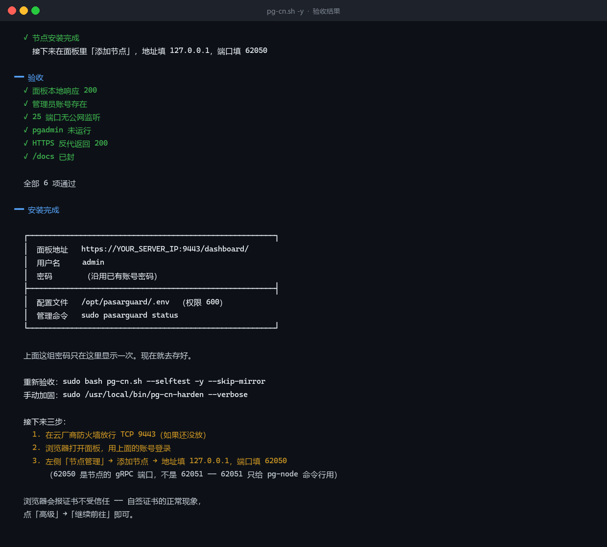
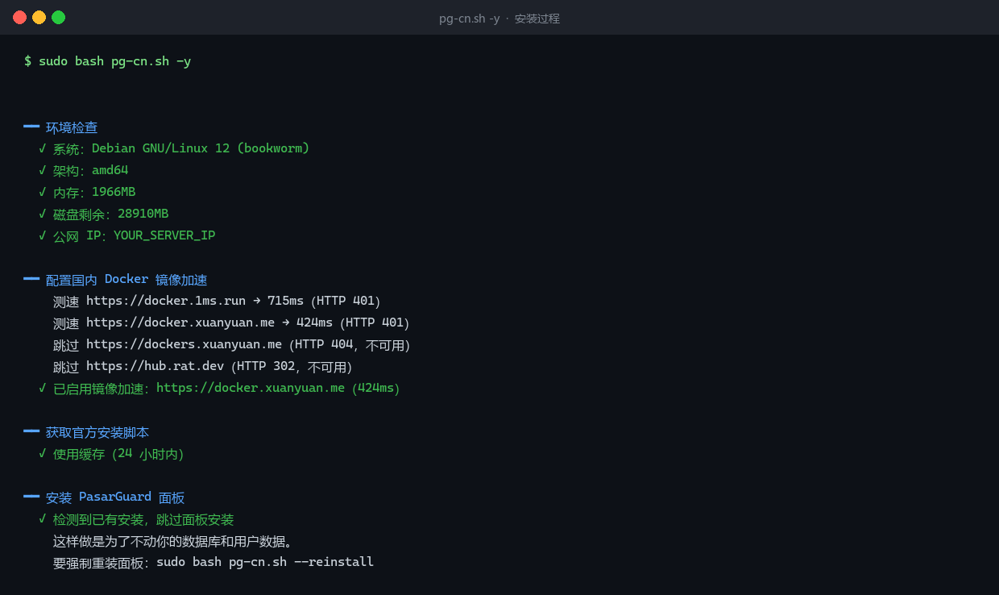
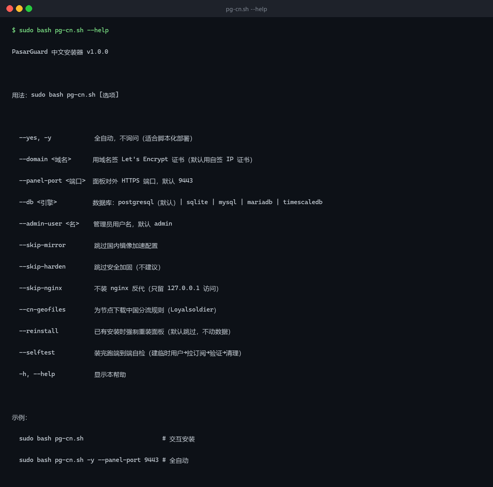

<div align="center">

# pasarguard-cn

**PasarGuard 官方安装脚本的中文安全加固外壳**

[](https://www.gnu.org/software/bash/)
[](https://www.debian.org/)
[](https://ubuntu.com/)
[](LICENSE)

**中文** | [English](README.en.md)

不重复造轮子 —— 核心安装仍然走官方脚本，这里只补官方没做的五件事

</div>

---

## 实际跑起来长这样

**装完的验收结果**（六项全过）：



**安装过程**：环境检查 → 镜像测速优选 → 幂等检测（已装则跳过，不动数据）：



**命令行参数**：




---

## 来源与定位

**本项目不是 PasarGuard 官方项目**，是第三方封装层。

| 项 | 说明 |
|---|---|
| 核心安装 | 调用官方 `pasarguard.sh` / `pg-node.sh`，**不修改其本体** |
| 本仓库提供 | 中文交互、自动建管理员、默认安全加固、国内镜像优选、nginx 反代 |
| 官方更新 | 自动受益（每次运行都重新拉取官方脚本，不走 fork） |
| 出问题时 | 先查[官方文档](https://docs.pasarguard.org/)，确认是封装层的问题再来提 Issue |

官方行为变化不受本仓库控制。若官方调整参数或流程导致本脚本失效，
请以官方文档为准，并在 Issue 里反馈。

---

## 为什么会有这个项目

官方脚本很强：5 种数据库、Let's Encrypt、Telegram 自动备份、灾备恢复、多节点、8 个发行版支持、CI 测试齐全。

但我在自己机器上装的时候踩了五个坑，都是官方目前没处理的：

### 1. 装完没有管理员账号，面板登不进去

官方脚本跑完，`admins` 表是空的：

```bash
$ docker exec pasarguard-postgresql-1 psql -U pasarguard -d pasarguard \
    -t -A -c "SELECT count(*) FROM admins;"
0
```

脚本只处理 `PGADMIN_EMAIL` / `PGADMIN_PASSWORD`（那是数据库管理界面，不是面板账号）。
面板自己的登录账号需要另外建 —— 但它不告诉你。

### 2. pgadmin 默认启动，宿主机 25 端口对公网开放

官方 compose 里 pgadmin 是常驻服务。它镜像内置 Postfix，在 `network_mode: host` 下直接绑 `0.0.0.0:25`：

```
$ ss -tln | grep ':25 '
LISTEN 0  100  0.0.0.0:25  0.0.0.0:*   users:(("master",pid=1047465))
```

开放 25 的 VPS 会在几天内被扫成垃圾邮件中继。IP 进黑名单之后，**你的代理节点跟着一起废**。

### 3. 没有 `--yes`，没法自动化

`pasarguard.sh` 的全部参数只有：

```
--database  --dev  --pre-release  --version  --ssl  --no-ssl  --ssl-domain
```

没有 `--yes` / `--non-interactive`。跑到最后一定会卡在这里等输入：

```
Want to install node on same server?
Do you want to install PasarGuard node? (y/n)
```

意味着你没法用 Ansible、没法批量开机器、没法写 CI。

### 4. 全英文，没有中文

不是"翻译一下"的问题 —— 报错信息是英文的情况下，中文用户很难判断
`CERTIFICATE_VERIFY_FAILED: IP address mismatch` 到底是证书问题还是网络问题。

### 5. 国内拉镜像会超时

官方只做了伊朗国内镜像（ArvanCloud / HamDocker / IranServer），
在国内拉 `pasarguard/panel` 那个几百 MB 的镜像经常卡住。

---

## 它补了什么

| | 官方脚本 | 本脚本 |
|---|---|---|
| 面板 / 节点安装 | ✅ | ✅ **调用官方**（自动跟进上游） |
| 数据库选择 | ✅ 5 种 | ✅ 透传 |
| Let's Encrypt | ✅ 域名 + IP | ✅ 透传 |
| 备份 / 灾备 | ✅ | ✅ 透传（`sudo pasarguard backup`） |
| **管理员账号** | ❌ 需手动 | ✅ **自动创建（bcrypt，owner 角色）** |
| **25 端口** | ⚠️ pgadmin 默认开 | ✅ **停 pgadmin + compose profile + iptables 双封** |
| **非交互部署** | ❌ | ✅ **`-y` 全自动** |
| **中文界面** | ❌ | ✅ |
| **国内镜像加速** | ❌ | ✅ **测速选最快** |
| **nginx HTTPS 反代** | ⚠️ 需用 `--ssl` 或自己配 | ✅ **`--no-ssl` 后自动补** |
| 操作系统 | 8 个发行版 | Debian / Ubuntu（其余用官方） |

**设计原则：能透传就透传，只在官方缺失的地方加壳。** 这样上游更新你不用追。

### 加固是「可重放」的，升级不会静默回到不安全状态

官方的 `pasarguard update` 会重建容器，可能用上游模板重写 `docker-compose.yml` ——
本脚本加的 `profiles: ["admin"]` 会被冲掉，pgadmin 复活，25 端口重新暴露。

所以加固逻辑被拆成独立脚本 `/usr/local/bin/pg-cn-harden`（幂等），并由 systemd 重放：

```bash
systemctl status pg-cn-harden.timer   # 开机 2 分钟后 + 每 15 分钟
/usr/local/bin/pg-cn-harden --verbose # 手动跑一次
```

**升级面板后不需要做任何事**，15 分钟内加固自动回来。

### 重跑是安全的（幂等）

```bash
sudo bash pg-cn.sh -y     # 第二次跑：检测到已有安装，跳过面板安装
```

- 面板已装 → **跳过**，不动你的数据库和用户
- 节点已装 → **跳过**，不会重签证书导致节点变 `error`
- 管理员已存在 → **跳过**，不覆盖密码
- 加固 / nginx → **重新应用**（幂等）

要强制重装：`sudo bash pg-cn.sh --reinstall`（数据卷仍保留）

### 内置端到端自检

```bash
sudo bash pg-cn.sh --selftest -y
```

会建一个临时用户 → 生成订阅 token → 请求订阅接口 → 验证内容 → 删掉临时用户：

```
━━ 端到端自检
  ✓ 临时用户已建（id=3）
  ✓ 订阅 token 已生成
  ✓ 订阅接口返回 200
  ! 节点已登记（1 个），但还没有「主机」配置
    订阅内容由 hosts 表生成，添加节点时面板会自动创建。
  ✓ 临时用户已清理
```


---

## 快速开始

```bash
# 交互式
sudo bash pg-cn.sh

# 全自动
sudo bash pg-cn.sh -y

# 用域名 + Let's Encrypt
sudo bash pg-cn.sh --domain panel.example.com

# 装到自定义端口
sudo bash pg-cn.sh -y --panel-port 8443
```

装完会打印一组凭据：

```
┌────────────────────────────────────────────────────────┐
│  面板地址   https://1.2.3.4:9443/dashboard/            │
│  用户名     admin                                      │
│  密码       Xk9mP2vQ7nL4wR8t                         │
└────────────────────────────────────────────────────────┘
```

**这组密码只显示一次。**

### 装之前必须做的一件事

在云厂商控制台放行 `9443`（或你指定的端口）TCP。

- 阿里云：ECS → 安全组 → 配置规则 → 入方向
- 腾讯云：CVM → 安全组
- 华为云：安全组
- 其他商家：找「防火墙」「安全组」或「网络 ACL」，效果一样

不放行的话脚本能装完，但你浏览器连不上。

---

## 装完三步

### 1. 登录面板

浏览器打开 `https://你的IP:9443/dashboard/`

会提示证书不受信任 —— **自签证书的正常现象**，点「高级」→「继续前往」。

### 2. 添加节点

左侧「节点管理」→ 添加节点：

| 字段 | 填什么 |
|---|---|
| 名称 | `Main` |
| 地址 | `127.0.0.1` |
| 端口 | `62050` |
| API Key | 脚本运行时会打印（UUID 格式） |
| 证书 | 脚本会打印，或从 `/var/lib/pg-node/certs/ssl_cert.pem` 取 |

**端口别填错**：`62050` 是节点的 gRPC 端口，面板连的是这个。
`62051` 是 `pg-node` 命令行自己用的 API 端口，填进面板会一直 `error`。

不确定的话直接读出来：

```bash
grep '^SERVICE_PORT' /opt/pg-node/.env
```

### 3. 建用户

「用户管理」→ 添加 → 设流量额度和到期日 → 复制订阅链接。

---

## 命令行

装完后官方 CLI 可用了：

```bash
sudo pasarguard status      # 容器状态
sudo pasarguard logs        # 实时日志
sudo pasarguard restart     # 重启
sudo pasarguard backup      # 立即备份
sudo pasarguard update      # 升级（拉新镜像重建）

sudo pg-node status         # 节点状态
sudo pg-node logs           # 节点日志
sudo pg-node renew-cert     # 重签节点证书
```

**注意**：`sudo pasarguard update` 会重建容器。如果它同时重写了 `docker-compose.yml`，
本脚本加的 `profiles: ["admin"]` 会丢，pgadmin 会回来。
升级后跑一次：

```bash
bash pg-cn.sh --skip-nginx --skip-mirror -y   # 只重新加固
```

---

## 中文排障

### 面板打不开

```bash
# 1. 面板本身活着吗
curl -s -o /dev/null -w '%{http_code}\n' http://127.0.0.1:8000/
# 期望 200

# 2. nginx 活着吗
systemctl status nginx
nginx -t

# 3. 端口在听吗
ss -tln | grep 9443
```

三层逐个过，哪层断了就修哪层。

### 节点显示 `error`

面板 → 节点管理 → 看「消息」字段：

| 消息 | 原因 | 修法 |
|---|---|---|
| `certificate verify failed` | 证书和数据库里的 `server_ca` 不一致 | 重新添加节点，或用 `pg-node renew-cert` 后更新面板里的证书 |
| `IP address mismatch` | 证书 SAN 缺 `127.0.0.1` | `sudo pg-node renew-cert` |
| `connection refused` | 节点服务没起 | `sudo pg-node status` / `sudo pg-node restart` |
| `backend not initialized` | 节点重启后后端未初始化 | `sudo pg-node restart` |

### 用户连上但没网

```bash
# 1. 节点有没有同步到用户
sudo docker logs node --tail 20 | grep -i synced

# 2. 用户有没有绑分组
docker exec pasarguard-postgresql-1 psql -U pasarguard -d pasarguard \
  -c "SELECT u.username, g.name FROM users u
      JOIN users_groups_association a ON a.user_id = u.id
      JOIN groups g ON g.id = a.groups_id;"
```

用户不在任何分组里 → 订阅是空的。

### 订阅 404

```bash
# 检查 nginx 有没有劫持 /sub/
grep -n -A3 'location /sub/' /etc/nginx/sites-available/pasarguard
```

**不应该有输出。** 面板自己的订阅路由就是 `/sub/<token>`，加 location 会覆盖它。

### 速度慢

先分清是哪一段慢：

```bash
# 服务器到外网
curl -o /dev/null -w '%{speed_download}\n' https://speed.cloudflare.com/__down?bytes=100000000

# 客户端到服务器（在你自己电脑上测）
curl -x socks5://127.0.0.1:10808 -o /dev/null -w '%{speed_download}\n' \
  https://speed.cloudflare.com/__down?bytes=100000000
```

- 服务器快、客户端慢 → 跨境链路丢包，**不是配置问题**
- 两边都慢 → 查服务器带宽和流量包

跨境丢包只能靠**国内中转**解决，改配置没用。实测过的无效手段：
Hysteria2（UDP 被限速）、fq_codel、MTU 1400、激进重传参数。

唯一有效的三条写在脚本里了：`tcp_notsent_lowat=16384`、MTU 1500、32MB 缓冲区。

---

## 实测范围（发布前必读）

**这个脚本只在一种环境上完整跑通过。**

| 环境 | 状态 | 说明 |
|---|---|---|
| Debian 12 (bookworm) amd64 | ✅ **完整实测** | 全新安装、幂等重跑、自检、加固重放全部验证 |
| Debian 11 / 13 | ⚠️ 理论兼容 | 未实测 |
| Ubuntu 22.04 / 24.04 | ⚠️ 理论兼容 | 未实测。apt / systemd 行为一致，但 Ubuntu 的 ufw 默认状态可能导致 iptables 冲突 |
| arm64 | ⚠️ 未实测 | 脚本有架构检查，但没在 ARM 机器上跑过 |
| 域名 + Let's Encrypt | ⚠️ 未实测 | `--domain` 代码路径写了，没有可用域名验证 |
| 节点连通 | ✅ 实测 | `connected` 状态已验证 |
| 订阅端到端 | ⚠️ 部分 | 接口返回 200 已验证；内容依赖面板 UI 添加节点 |

**如果你在 Ubuntu 上跑出问题**，请提 Issue 附：

```bash
cat /etc/os-release | head -3
sudo bash pg-cn.sh -y 2>&1 | tail -50
```

---

## 已知限制

| 限制 | 说明 | 怎么绕过 |
|---|---|---|
| **节点入站要手动加一次** | 脚本只装节点 agent，Reality 入站和主机配置由面板 UI 生成（那部分逻辑在 UI 里，重实现容易跟上游漂移） | 面板 → 节点管理 → 添加节点，一次性，约 1 分钟 |
| **Ubuntu 未实测** | 只在 Debian 12 实跑过，Ubuntu 22/24 理论兼容（同一套 apt / systemd） | 用 Ubuntu 的话先开一台测试机跑一遍 |
| **域名 + Let's Encrypt 未实测** | 代码路径写了（`--domain`），但没有可用域名验证 | 有域名的话先测；不确定就用默认自签 |
| **`--reinstall` 会覆盖 compose/.env** | 数据卷保留，但自签证书、pgAdmin 密码会重新生成 | 非必要不用 |

---

## 常见问题

**Q：为什么不直接给个完整脚本，非要调官方？**

因为官方在持续更新（5.4 → 5.6 我实测只隔了几天）。fork 一份就等于你要一直追。
现在这个结构，官方修 bug 你自动受益，我只维护中文层和加固逻辑。

**Q：能不能只装面板不装节点？**

可以。`-y` 模式默认装节点，想跳过就交互式运行时回答 `n`。

**Q：支持 CentOS / Arch 吗？**

本脚本只测过 Debian 12。其他系统请直接用官方脚本，本文档的排障思路仍适用。

**Q：`--no-ssl` 和默认有什么区别？**

官方默认会走交互式 SSL 向导。本脚本固定用 `--no-ssl`（面板绑 127.0.0.1:8000），
然后自己配 nginx 做 TLS 终止。好处是订阅链接、反代、证书全在一个地方管。

**Q：安全吗？**

默认状态：

| 项 | 状态 |
|---|---|
| 面板明文 8000 | 只绑 127.0.0.1 |
| 数据库 5432 / 6432 | 只绑 127.0.0.1 + iptables 封 |
| pgadmin 8010 | 不启动 |
| 25 (SMTP) | 不监听 + iptables 双封 |
| `/docs` `/openapi.json` | 404 |
| 对外端口 | 只有 22 / 9443 / 节点端口 |

**没做但建议你做**：SSH 改密钥登录、装 fail2ban、定期备份。

---

## 许可

[MIT](LICENSE)。你可以自由使用、修改、商用、闭源再分发，只要保留版权声明。

**边界说明**：

- 本仓库只包含部署辅助脚本，**不含 PasarGuard 本体的任何代码**
- 调用官方脚本时使用的是上游发布的原始文件，不作修改
- 若你把本项目再发布或商用，请遵循 MIT 条款保留 `LICENSE` 与版权声明

---

## 相关链接

- 官方面板：[PasarGuard/panel](https://github.com/Pasarguard/panel)
- 官方脚本：[PasarGuard/scripts](https://github.com/PasarGuard/scripts)
- 官方文档：[docs.pasarguard.org](https://docs.pasarguard.org/)
